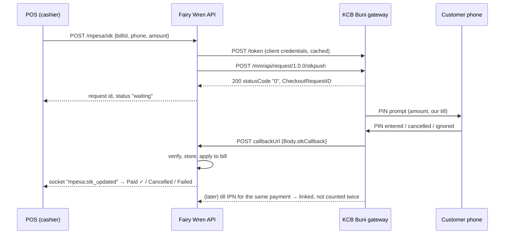

# KCB M-Pesa Express (STK Push) — Implementation Plan

_Date: 2026-11-25 · Status: **phases 2 (API) and 3 (POS) built 2026-11-26, not committed; waiting on KCB (phase 0) for UAT. Phase 4 (ERP) pending.** See §9._
_Sources: KCB M-Pesa STK Push API Specification v1.0, the Buni "STK Push" Postman collection_

## 1. What it adds

Today the customer has to open M-Pesa, enter paybill 522533 and our account number, and type the
amount. With STK Push, the cashier taps **"Send M-Pesa prompt"** on the bill. The customer's phone
shows a PIN prompt with the amount already filled in, and once they enter their PIN, the bill is
marked paid automatically. Nobody types an amount or a reference, so there is nothing to match by hand.

It builds on the IPN work. Payments land in the same `mpesa_transactions` table and are applied
through the same `allocate_mpesa_transaction()`, so the same journals (Dr 1020/2300 → Cr 1201), the
ERP M-Pesa register and the Z-report all cover STK payments with no extra work.



---

## 2. The KCB interface (from the spec)

| Step | Call | Notes |
|---|---|---|
| Token | `POST https://uat.buni.kcbgroup.com/token?grant_type=client_credentials`, Basic auth = consumer key : consumer secret | Cache until expiry; refresh about 60 s early. Production host to be confirmed. |
| STK request | `POST https://uat.buni.kcbgroup.com/mm/api/request/1.0.0/stkpush` with `Authorization: Bearer …`, and from the Postman collection `routeCode: 207`, `operation: STKPush`, `messageId: <unique>` | These three headers aren't in the PDF; confirm with KCB that they're required. |
| Body | `phoneNumber` (2547…), `amount` (string), `invoiceNumber` (`TILLNO-OURREF`, ≤30 chars), `sharedShortCode: true`, `orgShortCode: ""`, `orgPassKey: ""`, `callbackUrl` (https, **≤50 chars**), `transactionDescription` (≤30 chars) | |
| Immediate reply | `header.statusCode "0"` = accepted; `response.MerchantRequestID`, `response.CheckoutRequestID` | The spec shows `CheckoutRequestID` as both `false` and `"ws_CO_…"`. Handle both, and key on `MerchantRequestID`. |
| Callback (async) | `Body.stkCallback`: `MerchantRequestID`, `CheckoutRequestID`, `ResultCode`, `ResultDesc`, and on success `CallbackMetadata.Item[]` (Amount, MpesaReceiptNumber, TransactionDate `yyyyMMddHHmmss`, PhoneNumber) | Codes in the spec: 0 paid · 1032 cancelled by customer · 1037 phone unreachable · 2001 wrong PIN. Any other code = failed. |

### Constraints that shape the design
- **The callback is not signed.** Unlike the IPN, the spec gives the STK callback no signature, so
  anyone who learns the URL could post a fake "paid". Defences, all planned:
  1. **A secret token in the callback URL**, unique to each request (`/kcb/stk/<12-char token>`). We
     only store its hash.
  2. The callback must name a request **we sent** that is still pending, and its
     `MerchantRequestID` must match.
  3. The **amount and phone must equal what we requested**.
  4. Optionally, restrict the URL to KCB's IP addresses (to ask KCB).
- **`callbackUrl` is limited to 50 characters.** `https://api.fairywren.co.ke/kcb/stk/` is 36
  characters, which leaves room for a 12–14 character token. That's why the route lives at
  `/kcb/stk/:token`, not under `/integrations/kcb/…`.
- **`invoiceNumber` is limited to 30 characters**, in the form `KCBTILLNO-YOURACCREF`. Our till
  number is still to come from KCB, and bill ids (UUIDs) are too long, so each prompt gets its own
  6-character reference such as `FWZ1SW` (§8). The PDF uses `-` as the separator while Postman uses
  `#`, so we need to confirm which.
- **There's no "query status" API in these docs.** If no callback arrives, we can't ask KCB what
  happened. A prompt with no answer after **3 minutes** is marked *No response*. The till IPN (if KCB
  sends one) still catches a payment that went through.

---

## 3. STK callback vs IPN: which one records the money? (**decided: A**)

> **Decision (2026-11-25):** the STK callback clears the bill. The till IPN for the same payment is
> marked **used**, so it never shows among the open IPN payments for reconciliation.
>
> **Order of arrival:**
> - **IPN arrives while the prompt is still waiting:** it carries our `FW…` reference, so it is
>   held for that prompt and hidden from the open list, so a cashier can't match it by hand meanwhile.
>   The callback then links it.
> - **Callback never arrives** (no response) but the IPN shows the money came in: the held IPN is
>   applied to the bill instead. The money is never lost.
> - **Callback first, IPN later:** the IPN is linked as used on arrival.

A successful STK payment arrives at our till, so KCB will most likely **also** send the till IPN for
it. If both were recorded, the money would be counted twice.

| Option | How it works | For | Against |
|---|---|---|---|
| **A. The STK callback applies the payment (recommended)** | On `ResultCode 0`, store the payment and apply it to the bill straight away. When the IPN for the same payment arrives, it's recognised by our reference and stored as a linked duplicate: no journal, not shown in the inbox. | Fastest for the cashier (seconds). Works even if KCB never sends an IPN for STK payments. | Needs a reliable way to recognise the duplicate IPN (see below). |
| B. The IPN applies the payment | The callback only updates the on-screen status. The IPN, matched by our reference, applies the payment. | One source of money, the signed IPN. | Fails if KCB doesn't send IPNs for STK payments. The bill isn't paid until the IPN arrives. |

**Recognising the duplicate (for A)** requires a field present in both messages. The candidates are
our reference (`invoiceNumber` → IPN `notificationData.businessKey`?) or the M-Pesa receipt
(callback `MpesaReceiptNumber` → IPN `transactionID` / `narration`?). **This is the first question
for KCB.** Until it's answered, a second safety net applies: an IPN with the same phone and amount
within 10 minutes of a paid STK request is flagged *possible duplicate* in the ERP, not
auto-credited.

---

## 4. Design

### 4.1 Data (migration `2026xxxx_mpesa_stk_requests.sql`)
```
mpesa_stk_requests
  id uuid PK, bill_id → bills, requested_by → profiles
  phone text, amount numeric(12,2)
  account_ref char(6) UNIQUE                 -- FW + 4 chars (§8), e.g. FWZ1SW; never reused
  callback_token_hash text                   -- sha256 of the URL token
  merchant_request_id text UNIQUE, checkout_request_id text
  status  pending | waiting | paid | cancelled | failed | no_response | request_failed
  result_code int, result_desc text
  mpesa_receipt text, paid_amount numeric, paid_at timestamptz
  mpesa_transaction_id → mpesa_transactions  -- the money record it created/linked
  raw_request jsonb, raw_response jsonb, raw_callback jsonb
  created_at, updated_at
mpesa_transactions: source CHECK gains 'kcb_stk'; new column duplicate_of uuid (IPN linked to an STK payment)
```

### 4.2 API
| Piece | Responsibility |
|---|---|
| `integrations/buni.client.js` | Token cache, `stkPush()`, timeouts (10 s), and logging of every call (secrets redacted) into System Logs |
| `POST /mpesa/stk` (`send_mpesa_stk`; all `/mpesa/stk` routes) | Validate the bill (open, balance ≥ amount) and the typed phone (normalise to 2547…/2541…). **One active prompt per bill.** Take the next `FW…` reference (§8), create the row, call KCB, return the request. |
| `GET /mpesa/stk/:id` | Status, for polling if the socket is down |
| `POST /kcb/stk/:token` (public) | Callback: run the checks in §2, then record the result. On success, create an `mpesa_transactions` row (`source='kcb_stk'`, `transaction_id` = M-Pesa receipt) and call `allocate_mpesa_transaction()` for the bill, all in one DB transaction. Always reply 200 so KCB doesn't keep retrying. |
| Sweeper (node-cron, every minute) | `waiting` older than 3 min → `no_response` |
| IPN service change | An IPN whose reference matches an STK prompt is **marked used** (`duplicate_of` set, no journal, `status='allocated'`) and never listed as open. If the prompt is still waiting, it's held for that prompt; if the prompt ends with no callback, the held IPN is applied to the bill (§3). |
| Socket | `mpesa:stk_updated` → `perm:send_mpesa_stk` |

Configuration (`.env`, never committed): `KCB_BUNI_BASE_URL` (the only address setting: host only, the token and STK paths are fixed in code), `KCB_CONSUMER_KEY`,
`KCB_CONSUMER_SECRET`, `KCB_STK_TILL_NUMBER`, `KCB_STK_CALLBACK_BASE`
(`https://api.fairywren.co.ke`), and `KCB_STK_ENABLED` (off until go-live, which hides the POS button).

### 4.3 POS
- In both payment modals, M-Pesa → **"Send prompt to phone"**:
  - **Phone:** typed by the cashier for every prompt. It isn't pre-filled or saved to the customer
    record, only on the prompt itself.
  - **Amount:** the balance, and editable for split payments.
  - **Send:** sends the prompt.
- A live status card:
  - *Waiting for customer (0:42)…*;
  - then **Paid ✓** (the bill updates, and the modal closes if it's fully paid);
  - or *Cancelled by customer*, *Wrong PIN*, *Phone unreachable*, *No response*, each with **Resend**.
- Resend allows one active prompt per bill and waits 20 s between sends, so a customer can't be
  spammed.
- The existing "received payments" picker stays: customers can still pay the manual way.

### 4.4 ERP
- The M-Pesa register shows a **Source** column (Till / STK) and STK results.
- A new **STK requests** view lists sent, paid, cancelled, failed and no-response prompts per
  cashier, with success rate. It's useful for spotting phones that never answer.
- *Possible duplicate* flags (§3) appear on the Unmatched view for a manager to confirm.

---

## 5. Phases

| # | Phase | Depends on |
|---|---|---|
| 0 | **KCB / Buni onboarding:** register on the Buni portal, get UAT consumer key/secret, our till number, and answers to §6 | — |
| 1 | **Deploy IPN matching (phase 3 of the IPN plan)** — STK reuses `mpesa_allocations` / `allocate_mpesa_transaction` | Your go-ahead to commit phases 3–4 |
| 2 | API: Buni client, migration, initiate/status/callback, sweeper, IPN de-duplication, tests (callback forgery, amount mismatch, duplicate callback, duplicate IPN) | 0, 1 |
| 3 | POS: send-prompt UI and live status (both modals) | 2 |
| 4 | ERP: source column, STK requests view, duplicate flags | 2 |
| 5 | UAT on KCB sandbox with test phones; check every ResultCode path | 0–4 |
| 6 | **Go-live:** signed production request letter to buni@kcbgroup.com (template on the developer portal), production keys, `KCB_STK_ENABLED=true` | 5 |

---

## 6. Questions for KCB (send together)
1. When an STK Push to our till succeeds, does KCB **also send the till IPN**? Which IPN field
   carries our `invoiceNumber` reference or the M-Pesa receipt?
2. `invoiceNumber` format: `TILLNO-REF` (PDF) or `TILLNO#REF` (Postman)? Our till number?
3. Are the headers `routeCode: 207`, `operation: STKPush` and `messageId` required? What format is
   `messageId`?
4. Is the **50-character** `callbackUrl` limit enforced?
5. Can the STK callback be **signed** (like the IPN), or can you give us your callback **IP
   addresses**?
6. Is there a **transaction status query** API for prompts that get no callback?
7. Production base URL for token and STK Push, and how token expiry is communicated.

---

## 7. Decisions

| # | Question | Decision (2026-11-25) |
|---|---|---|
| 1 | Which message records the money | **Option A.** The STK callback clears the bill, and the matching IPN is marked used, so it's excluded from open payments (§3). |
| 2 | Who can send prompts | **Its own permission `send_mpesa_stk`** ("Send M-Pesa Prompt"), assigned per role in ERP → Users → System Roles. The migration gives it to every role that has `allocate_mpesa`; remove it from roles that shouldn't send prompts. (Changed 2026-11-26; first decision was to reuse `allocate_mpesa`.) |
| 3 | Phone number | **Typed at each prompt.** Not pre-filled or saved to the customer. |
| 4 | Payment reference | **§8: `FW` + 4 characters, 6 in total** (e.g. `FWZ1SW`). Decided 2026-11-25; the date-based option in §8.1 was considered and not chosen. |
| 5 | Order: deploy IPN matching (phases 3–4) before STK | **Open.** I recommend deploying it first, because STK reuses its allocation logic. |

---

## 8. Invoice number (**chosen**, 2026-11-25)

**Format:** `FW` + 4 characters = **6 characters**, upper case, e.g. **`FWZ1SW`**. KCB's
`invoiceNumber` is then `<KCB till no>-FWZ1SW` (separator to be confirmed, §6 Q2).

| Property | How |
|---|---|
| Characters | Digits and letters except **I, L, O, U** (Crockford base32: `0123456789ABCDEFGHJKMNPQRSTVWXYZ`), so nobody confuses `0/O` or `1/I/L` when reading one out |
| Never repeated | Each prompt takes the next value of a database sequence (1, 2, 3 …). Because the sequence never cycles, a code is used once, even for cancelled or failed prompts. A `UNIQUE` constraint backs this up. |
| Not consecutive-looking | The sequence number is shuffled one-to-one before encoding (`code = (n × 648,059 + 369,601) mod 2²⁰`). Consecutive prompts get unrelated-looking codes, and the shuffle can't produce a repeat. |
| Capacity | 32⁴ = **1,048,576** codes, about **14 years at 200 prompts a day**. When it runs low, the database refuses new codes (it doesn't reuse one), and we lengthen to `FW` + 5. |
| Where it shows | On the customer's M-Pesa confirmation SMS (as the account reference), on the POS prompt status card, and in the ERP register, so staff can search by it. |

**Sample** (sequence number → code). I checked all 1,048,576 values by computer: no repeats.

| Prompt # | Code |
|---|---|
| 1 | `FWZ1SW` |
| 2 | `FWJTNQ` |
| 3 | `FW6KHJ` |
| 4 | `FWTCDD` |
| 5 | `FWE598` |
| 6 | `FW1Y53` |
| 7 | `FWNQ0Y` |
| 8 | `FW9FWS` |
| 9 | `FWX8RM` |
| 10 | `FWH1MF` |
| 100 | `FW4ZYD` |
| 1,000 | `FWCF1S` |

**Alternative, if you meant `FW` followed by 6 characters** (8 in total, e.g. `FW3K9X2M`): this
gives about 1.07 billion codes, which never runs out in practice. It still fits KCB's 30-character
`invoiceNumber`, but it's longer for staff to read out.

### 8.1 Date-based option (considered, not chosen)

**Format:** `FW` + `YY` + `MM` + a counter that restarts each month, e.g. `FW2611001` (November 2026,
1st prompt). Codes are readable, show the month, sort by date, and never repeat (year + month +
counter is unique).

**Capacity check against real volume.** M-Pesa payments from the local DB copy, Jan–Jun 2026:

| Month | M-Pesa payments | Busiest day |
|---|---|---|
| Jan 2026 | 329 | 50 |
| Feb 2026 | 298 | 42 |
| Mar 2026 | 421 | 35 |
| Apr 2026 | 613 | 66 |
| May 2026 | 648 | 56 |

Every prompt uses up a number, including cancelled, ignored and resent ones; say about 1.3 prompts
per payment. With 3 digits (999 a month), May would already need ~840, and volume doubled from
January to May.

| Variant | Example | Length | Per month | Verdict |
|---|---|---|---|---|
| `FW` + YYMM + **3 digits** | `FW2611001` | 9 | 999 | **Too tight.** Likely to run out in a busy month within a year |
| `FW` + YYMM + **4 digits** | `FW26110001` | 10 | 9,999 | **Recommended.** About 15× the busiest month so far |

**How the counter works:** a `mpesa_stk_ref_counters (month char(4) PK, last int)` row per month.
Each prompt runs `INSERT … ON CONFLICT (month) DO UPDATE SET last = last + 1 RETURNING last`, which is
atomic, so two tills sending at the same moment never get the same number. The month is taken in
**East Africa Time**. If a month ever reaches its limit, the API refuses new prompts with a clear
message rather than reusing a number. A `UNIQUE` constraint on `account_ref` backs this up.

**Trade-off vs §8:** date-based codes are predictable (the next one is easy to guess). That's
harmless here, because security rests on the secret callback token and on matching the request,
not on the reference.

---

## 9. Build status (2026-11-26)

### Built
| Piece | Where |
|---|---|
| Migration: `FW` reference generator (sequence + shuffle, verified 1,048,576 unique, sample matches §8), `mpesa_stk_requests`, `kcb_stk` source, `linked` status, `duplicate_of` / `possible_duplicate_of`, callback / IPN-link / expiry functions, socket trigger | `api/src/database/migrations/20261126_002_mpesa_stk.sql` |
| Buni client: token cache, STK push, 10 s timeout, redacted logging, **mock mode** for development | `api/src/modules/integrations/buni.client.js` |
| Service: send prompt, status, callback, sweeper; routes `GET /mpesa/stk/config`, `POST /mpesa/stk`, `GET /mpesa/stk?billId=`, `GET /mpesa/stk/:id`; public `POST /kcb/stk/:token` | `api/src/modules/mpesa/stk.*`, `integrations/kcb.stk.routes.js` |
| IPN handler links each new till IPN to a prompt before any receipt journal | `integrations/kcb.service.js` |
| POS: "Send M-Pesa prompt" panel in both payment modals, live status (socket + 4 s poll), countdown, resend with 20 s cooldown, bill refresh / modal close when paid | `pos/src/components/mpesa/MpesaStkPanel.jsx` |

**One change from §3 wording:** an IPN that carries a prompt's reference while the prompt is still
waiting is *applied at once* (the prompt becomes paid "via IPN") instead of being held for the
callback. The outcome is the one decided, with the bill cleared, the money recorded once and the IPN
never open, but the cashier sees it sooner. A later callback is recorded as "already paid".

**Flagged possible duplicates** (same phone + amount within 10 min, no reference) are hidden from the
POS inbox. Until phase 4 adds the manager screen, they are visible only in the ERP register.

### Configuration (`api/.env`)
```
KCB_STK_ENABLED=true                       # off by default; hides the POS panel
KCB_STK_TILL_NUMBER=<from KCB>
KCB_STK_CALLBACK_BASE=https://api.fairywren.co.ke/kcb/stk/   # QA: https://api.fairywren.co.ke/kcb/qa/
KCB_STK_INVOICE_SEPARATOR=-                # or "#" (§6 Q2)
KCB_STK_DESCRIPTION=Fairy Wren             # optional, ≤30 chars
KCB_BUNI_BASE_URL=https://uat.buni.kcbgroup.com
KCB_CONSUMER_KEY=<from Buni portal>
KCB_CONSUMER_SECRET=<from Buni portal>
```
`KCB_STK_CALLBACK_BASE` is the callback address **up to the token**. The API appends `<token>`, and
the whole URL must stay within KCB's 50 characters. The token is 12 characters when there's room and
shrinks to fit, but never below 10.
- **Production:** `https://api.fairywren.co.ke/kcb/stk/<12>`, 48 characters, served by the API route
  `/kcb/stk/:token`.
- **QA:** `https://api.fairywren.co.ke/kcb/qa/<12>`, 47 characters. nginx must forward
  `/kcb/qa/<token>` to the QA API as `/kcb/stk/<token>`.
**Local testing without KCB:** add `KCB_STK_MOCK=true` (ignored when `NODE_ENV=production`), with
`KCB_STK_TILL_NUMBER=000000` and `KCB_STK_CALLBACK_BASE=http://localhost:8000`. The phone's last 4
digits pick the outcome: `…1032` cancelled, `…1037` unreachable, `…2001` wrong PIN, `…9999` no
answer (expires after 3 min), anything else paid after ~4 s.

### Tested
- 46 new unit/route tests (`api/src/modules/mpesa/__tests__/stk.service.test.js`). The full API
  suite has the same 20 old failures as before, with 158 passing.
- End-to-end against the local DB with the mock: paid by callback → bill completed with journals;
  IPN copy linked with no journal; cancelled; one active prompt per bill; 20 s cooldown; no callback
  then IPN with our reference (any case) → paid via IPN; forged and late callbacks ignored with no
  new money; possible duplicate flagged and hidden from the POS; sweeper → no response. All test data
  was removed afterwards.

### Still to do
- **Phase 0 (KCB):** the §6 answers, UAT keys and the till number. The parts that depend on them are
  settings: the separator, the headers, and which IPN field carries the reference.
- **Phase 4 (ERP):** Source column and STK results in the register, an STK requests view, and a
  manager screen to confirm or release possible duplicates.
- Phase 5 UAT on the KCB sandbox, then phase 6 go-live.

### Change: invoice number on every bill (2026-11-26, migration `20261126_003_bill_invoice_number.sql`)
The `FW` + 4 code is now **the bill's invoice number** (`bills.invoice_number`), not a new reference
for each prompt.
- **Same code everywhere:** it's printed on the receipt as **Invoice #** and sent as the STK
  `invoiceNumber` (`TILLNO-FWxxxx`), so it appears on the customer's M-Pesa SMS. Every prompt for
  the bill (resends, split payments) carries the same code.
- **New bills:** numbered automatically by a trigger on insert, whatever code path creates them.
  The number can't be changed afterwards (`INVOICE_NUMBER_IMMUTABLE`).
- **Existing bills:** backfilled oldest first by `SELECT backfill_bill_invoice_numbers();`. The
  migration runs it, and it's safe to run again (it returns how many it numbered). Locally: 3,001
  bills, all unique.
- **Same generator:** the sequence is the same one (renamed `bill_invoice_seq`), so references
  already given to test prompts are never reused. Capacity is about 1.05M bills, more than a century
  at the current volume.
- **IPN linking:** the reference now identifies the bill, not one prompt. A till IPN is matched
  first by receipt, then to a prompt of that invoice paid by callback with the same amount (→ linked
  as its copy), then to the latest unpaid prompt of that invoice with the same amount (→ applied).
- **Automatic matching by invoice number (no prompt):** the receipt and the payment window show the
  paybill account as `8040662#FWxxxx`. A till IPN whose **bill reference** holds an invoice number
  (`8040662#FWPD0Z`, `8040662FWPD0Z`, `fwpd0z`; not inside another word, narration not used) is
  applied to that bill with no cashier action (allocation `allocated_by` NULL = shown as
  "Automatic"), up to the bill's balance; any excess stays open. Unknown invoice, or a bill that is
  completed/void/fully paid → the payment stays unallocated for the cashier.
- **Manual matching:** an unallocated payment whose reference holds an invoice number gets that bill
  as the top suggestion.
